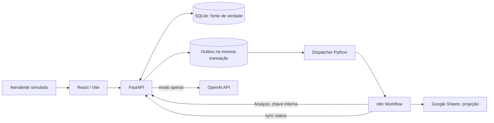

# AI Support Flow

**Triagem assistida por IA para chamados fictícios de suporte de TI, com revisão e encerramento humanos.**

Projeto independente de portfólio em Engenharia de IA/GenAI. MVP local executado com **React, FastAPI, SQLite, Outbox transacional, dispatcher Python, n8n, API da OpenAI e Google Sheets**. Não é produto corporativo nem serviço de suporte em produção. Todos os cenários devem usar dados sintéticos.

> **Status do MVP (17/11/2026):** fluxo principal validado manualmente no ambiente do autor; **23/23 testes automatizados aprovados localmente** (1 aviso de depreciação). Os testes automatizados usam serviços simulados. O build de produção do frontend e uma instalação limpa ainda precisam ser validados antes de apresentar o repositório como plenamente reproduzível.

## Demonstração resumida

1. Usuário abre um chamado no React; FastAPI persiste o registro no SQLite e insere um evento na Outbox na mesma transação.
2. Dispatcher encaminha evento ao webhook do n8n. O n8n solicita ao FastAPI a triagem; **somente o backend chama a OpenAI** quando `AI_MODE=openai`.
3. O backend valida o resultado estruturado, aplica regras de prioridade, registra modelo configurado e modelo informado pelo provedor e sinaliza necessidade de revisão humana.
4. n8n realiza *Append or Update Row* no Google Sheets usando `ticket_id` e comunica resultado ao backend.
5. Atendente demonstrativo revisa prioridade com justificativa, assume atendimento, registra resolução e encerra manualmente o chamado.

### Arquitetura



A publicação utiliza apenas portas no loopback (`127.0.0.1`) e o cabeçalho `X-Demo-Role` **não é autenticação real**. Não expor diretamente na internet.

## Tecnologias

| Componente | Implementação |
|---|---|
| Interface | React 19 + Vite 6 (frontend v0.4) |
| API | Python + FastAPI, Pydantic |
| Fonte de verdade | SQLite; histórico de estados e revisões |
| Processamento assíncrono | Outbox + dispatcher de instância única |
| Orquestração | n8n 2.0.0 (imagem padrão do Compose) |
| IA | API OpenAI Responses, saída JSON estruturada; modo mock alternativo |
| Projeção externa | Google Sheets com chave `ticket_id` |
| Testes | pytest + FastAPI TestClient, HTTP simulado, SQLite temporário |

## Pré-requisitos

- Docker Desktop com Docker Compose; Node.js/npm para a interface.
- Conta n8n local e credenciais próprias para Google Sheets; conta/API key OpenAI **somente se usar `AI_MODE=openai`** (pode gerar custos).
- Para testes locais fora do Docker: Python e dependências de `backend/requirements-dev.txt`.

## Instalação local — ambiente novo

Na raiz **`ai-support-flow/`** (esta é a raiz oficial do repositório Git, não a pasta externa de distribuição):

```powershell
Copy-Item .env.example .env
```

Edite **somente o `.env` local** com três segredos aleatórios, fortes e distintos (`ASF_INTERNAL_SERVICE_KEY`, `N8N_WEBHOOK_KEY`, `N8N_ENCRYPTION_KEY`). Comece com `AI_MODE=mock`. Não publique `.env`. Se estiver retomando ambiente existente, **não sobrescreva** seu `.env` e **não remova volumes**.

```powershell
docker compose up -d --build
docker compose ps
curl.exe http://127.0.0.1:8000/health
```

API: `http://127.0.0.1:8000/docs` · n8n: `http://127.0.0.1:5678`.

### Configurar o n8n e o Sheets

Importe `n8n/workflows/WF-001-ticket-triage.json` e configure, manualmente:

- Webhook: Header Auth `X-N8N-Key`, correspondente a `N8N_WEBHOOK_KEY`.
- Nós HTTP internos: Header Auth `X-Service-Key`, correspondente a `ASF_INTERNAL_SERVICE_KEY`.
- Google Sheets OAuth e identificação da planilha; aba **Chamados** com as colunas `ticket_id`, `category`, `priority`, `summary`, `ticket_status`, `timestamp`.
- Nó Google Sheets como **Append or Update Row**, coluna de correspondência `ticket_id`; substitua o identificador de planilha de exemplo.
- Publique/ative o workflow para habilitar a rota de produção `asf-ticket-created`. A importação por si só não configura credenciais.

### Iniciar o React

Em outro terminal:

```powershell
cd frontend
npm install
npm run dev
```

Abra `http://127.0.0.1:5173`. O Vite faz proxy de `/health` e `/tickets` para `127.0.0.1:8000`; não há chave OpenAI no navegador.

### Configurar OpenAI real (opcional)

Em `.env` local, defina `AI_MODE=openai`, `OPENAI_MODEL=<modelo acessível à sua conta>` e `OPENAI_API_KEY=<seu segredo>`. Recrie somente o backend:

```powershell
docker compose up -d --no-deps --force-recreate backend
```

O cenário local validado pelo autor usou o modelo configurado e retornado `gpt-6-luna` para o chamado sintético TCK-0006; isso **não garante disponibilidade pública do modelo para outras contas**. Chamadas reais podem ter cobrança.

## Fluxo do operador

O botão **Modo atendente** no React apenas adiciona `X-Demo-Role: attendant`. As permissões são simuladas e não servem para autenticação real. A IA **não fecha chamados**. O fluxo principal observado foi:

`created → processing → awaiting_review → in_progress → resolved → closed`

A revisão da prioridade registra a sugestão original, a nova prioridade, o responsável demonstrativo e uma justificativa. Priorização crítica depende de regras adicionais, e operações inválidas são rejeitadas.

## Testes e evidências

```powershell
cd backend
py -m venv .venv-stage8
.\.venv-stage8\Scripts\python.exe -m pip install -r requirements-dev.txt
.\.venv-stage8\Scripts\python.exe -m pytest -q
```

No ambiente Windows do autor, em 17/11/2026: **23 passed, 1 warning in 42.52s**. O aviso foi de depreciação na integração Starlette/TestClient; não foi falha de teste. A suíte isola APIs externas; não prova robustez sob indisponibilidade real do Google Sheets nem em múltiplas instâncias. Consulte `docs/TESTES-E-EVIDENCIAS.md`.

Para conferir o bundle React antes da publicação:

```powershell
cd frontend
npm run build
```

Esse build **não foi atestado** como concluído nesta documentação: execute-o localmente e registre o resultado.

## Documentação

- [Arquitetura e decisões](docs/architecture/ARCHITECTURE.md)
- [Contrato da API](docs/API.md)
- [Testes e evidências](docs/TESTES-E-EVIDENCIAS.md)
- [Segurança e limitações](docs/SECURITY.md)
- [Guia de publicação segura no GitHub](docs/GITHUB-PUBLICACAO.md)
- [Especificação aprovada](docs/specification/ASF-SPEC-001-v1.0.md)
- [Arquitetura de referência aprovada](docs/architecture/ASF-ARCH-001-v1.0.md)

## Limitações e próximos passos

Trata-se de um MVP **local**, com um dispatcher e uma instância de backend, sem autenticação e autorização reais; `dead_letter` exige intervenção; a projeção Sheets não garante *exactly once* em situações de concorrência e falhas externas. Para produção: login/roles reais, gestão de segredos, observabilidade, testes E2E em ambiente isolado, proteção de dados e implantação segura.

> Este projeto não contém nem deve incorporar dados privados ou artefatos internos de empregadores/clientes. Dados de demonstração são fictícios.

### Compatibilidade Windows / Linux

Os scripts de verificacao pre-publicacao estao em `scripts/check-publication.ps1` (Windows PowerShell) e `scripts/check-publication.sh` (Linux/macOS Bash). Os dois devem ser executados com o repositorio organizado sob a raiz `ai-support-flow/` e apenas fazem verificacoes locais de caminhos; revise manualmente o conteudo antes de publicar. Consulte `docs/GITHUB-PUBLICACAO.md`.
