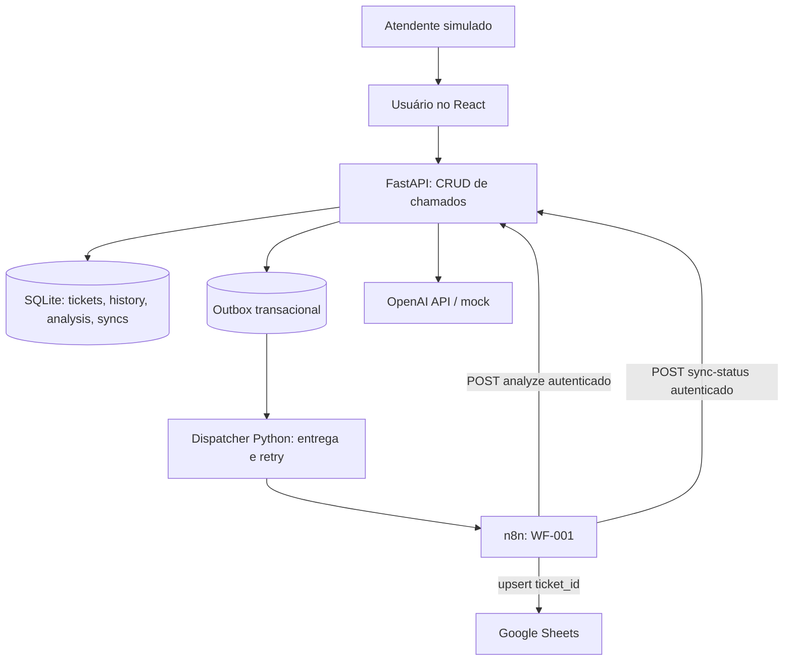
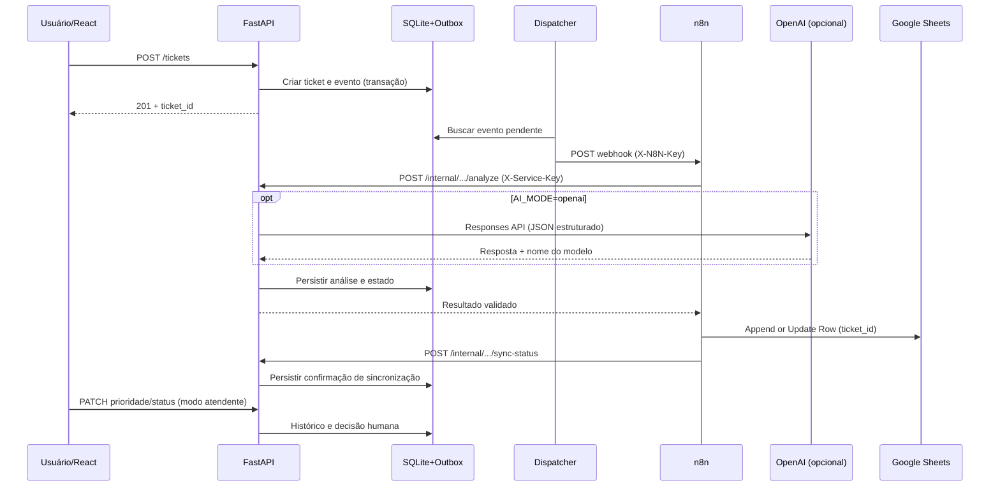

# Arquitetura de implementação — AI Support Flow

## Componentes e responsabilidades

- **API:** recebe e valida payloads, guarda o estado e protege operações internas com `X-Service-Key`.
- **SQLite:** fonte de verdade; guarda `tickets`, `analysis_results`, `outbox_events`, `ticket_status_history`, `priority_review_history` e `external_syncs`.
- **Outbox:** evento é inserido na mesma transação de criação ou retry do chamado; evita perda entre persistência e fila local.
- **Dispatcher:** uma instância; entrega com retry e backoff; após limite sinaliza `dead_letter` para intervenção operacional. Receber 2xx do webhook não comprova conclusão das integrações.
- **n8n:** orquestra a chamada interna de análise, atualização da planilha e callback de sincronização. Não acessa diretamente a chave OpenAI.
- **IA:** `AI_MODE=mock` ou `openai`. OpenAI retorna estrutura validada, regras determinísticas ajustam classificação e registram `model_name`, `provider_model`, `prompt_version`.
- **Sheets:** visão externa, não fonte de verdade. *Append or Update Row* usando `ticket_id` limita duplicação em uso normal; não equivale à garantia universal *exactly once*.
- **React:** frontend servido por Vite durante desenvolvimento, proxy de `/tickets` e `/health`; sem acesso a segredos internos.

## Diagrama de sequência

## Estados e separação de responsabilidades

`created → processing → awaiting_review → in_progress → resolved → closed`.

Os campos `analysis_status` e `sync_status` são **independentes** do `ticket_status`; sucesso na análise não implica atendimento concluído. Falhas podem exigir intervenção e nova tentativa. O encerramento é manual e fica no histórico.

## Idempotência e consistência

- O `event_id` identifica a tentativa. A API bloqueia eventos inconsistentes e reutilizações que violam o estado; testes cobrem reenvios.
- `external_syncs` mantém estado de sincronização; callbacks repetidos são tratados nos testes.
- Retry de análise gera novo evento, preservando histórico. Eventos fora da tentativa atual não podem sobrescrever o resultado mais recente.
- Instância única de dispatcher e SQLite local: **sem garantia de tolerância multi-instância**.

## Evolução para produção

Autenticação real (JWT/OIDC), autorização por papel no servidor, PostgreSQL para concorrência maior, tarefas gerenciadas, métricas/trace, observabilidade, DLQ operacional, HTTPS, limites de taxa, políticas de retenção e testes E2E em infraestrutura separada. A proposta de evolução não representa recursos já implementados.
