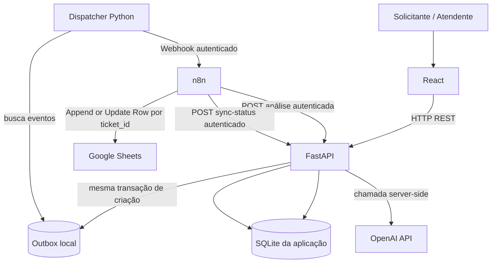

# AI Support Flow — Etapa 2: Arquitetura técnica (v1.0)

> **Estado:** APROVADA pelo usuário em 2026-11-08. Consolidação da proposta técnica v0.1 sem alterações de escopo. Esta aprovação autoriza iniciar a implementação, **não** comprova que o sistema já funciona.

## 1. Objetivo e decisões herdadas

Definir a arquitetura mínima que realiza RF-001–RF-012, RN-001–RN-008 e AC-001–AC-009 da especificação aprovada `ASF-SPEC-001@1.0`. O projeto é uma demonstração local reproduzível com dados sintéticos; não é proposta de sistema corporativo pronto para produção.

Decisões já aprovadas: React, FastAPI/Python, OpenAI API, n8n **obrigatório** como orquestrador, SQLite, sincronização demonstrativa com Google Sheets, Docker Compose, revisão/encerramento humano e proteção de segredos. O frontend não acessa diretamente n8n, OpenAI ou Google Sheets.

## 2. Distribuição de responsabilidades

| Componente | Responsabilidade | Não deve fazer |
|---|---|---|
| React | coletar relato, listar/detalhar chamados, exibir triagem, permitir revisão e encerramento no ambiente local | chamar API da OpenAI, guardar secrets, determinar prioridade final |
| FastAPI | validar entrada e estados, persistir dados, controlar autorização de serviços, chamar OpenAI, validar schema de IA, aplicar regras, disponibilizar API e registrar auditoria | depender da disponibilidade de n8n para salvar chamado |
| SQLite (aplicação) | verdade sobre chamados, análises, histórico e eventos pendentes | ser substituído pela planilha como fonte de verdade |
| Dispatcher/worker Python | procurar eventos de saída pendentes, notificar webhook e tentar novamente quando necessário | criar chamados duplicados ou disparar sem limite |
| n8n | iniciar e rastrear fluxo por webhook, acionar análise FastAPI, tratar ramificações, atualizar Google Sheets e reportar resultado | editar SQLite diretamente, decidir encerramento, armazenar API key OpenAI |
| OpenAI | sugerir análise de texto técnico em dados estruturados | executar comandos ou aprovar fechamento |
| Google Sheets | demonstrar integração externa com registro consultável | definir estados do atendimento |

## 3. Topologia lógica



## 4. Operação de ponta a ponta

1. `POST /tickets` recebe um relato válido. FastAPI persiste ticket `created` e um evento `ticket.created` **na mesma transação**.
2. A resposta de criação retorna com `ticket_id`, sem aguardar n8n/OpenAI/Sheets.
3. O dispatcher detecta o evento, faz POST ao webhook autenticado do n8n com `event_id` e `ticket_id` e registra tentativas e resultado de entrega. HTTP 2xx apenas confirma recebimento, não conclusão do fluxo.
4. n8n chama `POST /internal/tickets/{ticket_id}/analyze` com credencial de serviço e `event_id` para idempotência.
5. FastAPI consulta o chamado e verifica se o evento já foi processado. Se não, marca análise como `running`, chama OpenAI, valida saída JSON, registra resultado e calcula prioridade efetiva e necessidade de revisão.
6. Na resposta, n8n recebe um resultado de triagem, **sem depender de acesso ao banco**.
7. n8n faz `Append or Update Row` em Google Sheets usando `ticket_id` como coluna de correspondência e depois chama `POST /internal/tickets/{ticket_id}/sync-status` com `event_id`, status e metadados mínimos.
8. O atendente consulta o ticket, revisa quando necessário, move para `in_progress`, registra resolução (`resolved`) e posteriormente fecha (`closed`). Nenhum passo de fechamento é automático.

### Caminhos de falha

- **n8n inacessível:** o ticket e evento persistem no banco. O dispatcher tenta reenviar de acordo com retry limitado/backoff.
- **OpenAI falha/retorna JSON inválido:** FastAPI registra `analysis_status=failed`, define revisão manual e mantém o chamado consultável.
- **Google Sheets falha:** a análise bem-sucedida permanece salva; `sync_status=failed`. Retry controlado pode repetir a sincronização sem reanalisar o conteúdo.
- **Webhook chamado duas vezes:** `event_id` torna reenvios detectáveis; análise já completada pode retornar o resultado armazenado. Para Google Sheets, `Append or Update Row` reduz duplicação; concorrência externa será testada, e reconciliação poderá ser necessária. Não há promessa de entrega exatamente uma vez na rede.
- **Execução n8n interrompida após receber o webhook:** mecanismo de reconciliação local identifica workflow sem conclusão e permite reprocessamento controlado, mesmo se o POST inicial ao webhook tiver retornado 2xx.

## 5. Modelo de dados proposto

### `tickets`
- `id` UUID (chave técnica); `public_id` `TCK-NNNN` (único e estável)
- `title` TEXT NOT NULL; `description` TEXT NOT NULL
- `affected_service` TEXT; `reported_impact` TEXT
- `ticket_status` TEXT (`created`, `processing`, `triaged`, `awaiting_review`, `in_progress`, `resolved`, `closed`)
- `analysis_status` TEXT (`pending`, `running`, `succeeded`, `failed`)
- `sync_status` TEXT (`pending`, `succeeded`, `failed`)
- `effective_priority` TEXT NULL; `resolution_notes` TEXT NULL
- `created_at`, `updated_at`, `resolved_at` NULL, `closed_at` NULL

### `analysis_results`
- `id` UUID; `ticket_id` FK; `event_id` (para rastrear solicitação)
- `attempt_number`, `status`, `category`, `suggested_priority`, `summary`
- `recommendations_json`, `review_reason`, `requires_human_review`, `effective_priority`
- `model_name`, `prompt_version`, `error_code` NULL, `created_at`
- Proibir cópias arbitrárias do texto completo enviado ao provedor nos logs.

### `outbox_events`
- `event_id` UUID único; `ticket_id` FK; `event_type` (`ticket.created` inicialmente)
- `payload_json` mínimo; `state` (`pending`, `sent`, `retry`, `completed`, `dead_letter`)
- `attempts`, `next_attempt_at`, `last_error` NULL, `created_at`, `delivered_at` NULL
- `sent` significa entregue ao webhook; `completed` significa processamento final confirmado ou reconciliado.

### `ticket_status_history`
- `id` UUID; `ticket_id` FK; `previous_status`, `new_status`
- `actor_type` (`system`, `attendant`), `reason` NULL, `created_at`
- Toda transição de estado e correção relevante deve ser registrada.

### `external_syncs`
- `id` UUID; `ticket_id` FK; `provider` (`google_sheets`)
- `external_key` (`ticket_id`), `status`, `attempts`, `last_error`, `updated_at`
- Única por (`ticket_id`, `provider`) no MVP.

**Regra:** transições são validadas pela camada de serviço do FastAPI, não por edições manuais de tabelas ou expressões no n8n.

## 6. Contratos HTTP propostos

| Método e rota | Consumidor | Resultado | Segurança |
|---|---|---|---|
| `POST /tickets` | React | `201`, `ticket_id`, `ticket_status` | UI local/demonstração |
| `GET /tickets` | React | coleção resumida | UI local/demonstração |
| `GET /tickets/{id}` | React | detalhes, análise, histórico | UI local/demonstração |
| `PATCH /tickets/{id}/status` | atendente no React | estado atualizado ou `409` por transição inválida | perfil atendente simulado; não expor publicamente |
| `POST /internal/tickets/{id}/analyze` | n8n | categoria, prioridades, resumo, recomendações, revisão | chave de serviço |
| `POST /internal/tickets/{id}/sync-status` | n8n | confirmação de sincronização | chave de serviço |
| `GET /health` | testes/operador | disponibilidade básica do backend | sem segredos |

### Exemplo de payload FastAPI → n8n

```json
{
  "event_id": "f2583b83-61ba-4a90-aa95-0a770f57d82a",
  "event_type": "ticket.created",
  "ticket_id": "TCK-0001"
}
```

### Exemplo de análise FastAPI → n8n

```json
{
  "ticket_id": "TCK-0001",
  "event_id": "f2583b83-61ba-4a90-aa95-0a770f57d82a",
  "category": "network",
  "suggested_priority": "high",
  "effective_priority": "high",
  "summary": "Falha de conectividade informada no escritório.",
  "recommendations": ["Verificar alcance do problema", "Conferir equipamentos de rede"],
  "requires_human_review": true,
  "review_reason": "Possível indisponibilidade coletiva"
}
```

**Códigos de erro:** `400/422` (dados inválidos), `401/403` (credencial inválida), `404` (chamado inexistente), `409` (transição/conflito), `502/503` (serviço externo indisponível). Respostas terão `error_code` consistente e não revelarão credenciais nem prompts privados.

## 7. Workflow n8n proposto (WF-001)

```text
Webhook POST (Header Auth)
  -> valida presença de event_id e ticket_id
  -> HTTP Request: POST FastAPI /internal/.../analyze
  -> IF análise executada com sucesso?
      -> SIM: Google Sheets "Append or Update Row" (match ticket_id)
              -> HTTP Request: POST FastAPI /internal/.../sync-status [succeeded]
      -> NÃO: HTTP Request: informar falha ao backend
              -> encaminhar para revisão manual / retry controlado
```

- Ativar o workflow para usar URL de produção; a URL de teste serve apenas à edição e ao debug.
- Escolher resposta imediata do Webhook e confirmação posterior de processamento via callback ao backend.
- Credenciais do webhook, backend e Google Sheets ficam no gerenciador de credenciais do n8n e variáveis seguras locais; jamais no JSON exportado.
- Os registros em Sheets terão `ticket_id`, categoria, prioridade efetiva, resumo, estado e timestamp, sem dados pessoais.
- Fluxos de erro devem conseguir registrar falhas sem produzir loops infinitos.

## 8. Segurança mínima e limites do MVP

- O navegador fala apenas com a API FastAPI.
- n8n e API rodam em rede de serviços local definida pelo Docker Compose; endpoints internos não são expostos publicamente.
- Webhook do n8n exige autenticação por header. API interna verifica credencial independente da credencial usada pelo webhook.
- `OPENAI_API_KEY` fica exclusivamente no backend; credenciais Google Sheets exclusivamente no n8n.
- Tratar o conteúdo informado pelo solicitante como dado não confiável; saída estruturada do modelo passa por validação e regras.
- Perfis simulados permitem demonstrar revisão local, mas **não são autenticação/controle de acesso adequado para implantação na internet**.
- Volumes persistentes para banco da aplicação e estado/credenciais n8n; `.env` e dados locais excluídos do Git.

## 9. Organização inicial do repositório

```text
ai-support-flow/
├── frontend/                 # React
├── backend/
│   ├── app/
│   │   ├── api/              # rotas
│   │   ├── services/         # triagem, regra de prioridade, estados
│   │   ├── models/           # dados persistentes
│   │   ├── schemas/          # request/response
│   │   ├── integrations/     # OpenAI, n8n
│   │   └── workers/          # dispatcher e reconciliação
│   └── tests/
├── n8n/
│   └── workflows/            # export WF-001 sem secrets
├── docs/
│   ├── specification/
│   ├── architecture/
│   └── demo/
├── compose.yaml
├── .env.example
└── README.md
```

## 10. Testes da Etapa 2 e vínculos com aceitação

| Caso | Evidência esperada | Referência |
|---|---|---|
| Persistir ticket com n8n desligado | criado e evento pendente | RF-003, RN-001, AC-001 |
| Repetir webhook/evento | uma análise efetiva por evento | RF-004, RN-006, AC-006 |
| Enviar chamada interna sem credencial | acesso negado | RNF-003, AC-008 |
| IA inválida ou indisponível | histórico de falha e revisão humana | RF-008, RN-004, AC-005 |
| Google Sheets indisponível | análise preservada, sync falha e retry | RF-009, RN-008 |
| Pedir fechamento automático pelo n8n | operação não autorizada | RN-005, AC-007 |
| Completar workflow e encerrar manualmente | estados e eventos históricos consistentes | AC-002, AC-003, AC-007 |

## 11. Detalhes técnicos para concretização na implementação

1. **Worker/outbox:** confirmar implementação local simples do dispatcher em processo Python separado, com retries limitados e reconciliação de workflows iniciados.
2. **Critérios exatos da prioridade:** estabelecer regras de conflito entre recomendação da IA e impacto declarado, respeitando a exigência de confirmação humana para incidentes críticos.
3. **Simulação de perfis:** limitar rigorosamente a demonstrações locais, nunca apresentá-la como autenticação pronta para produção.
4. **Google Sheets:** validar comportamento do `Append or Update Row` e testes de reexecução, sem promessa de *exactly-once* distribuído.

## 12. Condição de aceite da Etapa 2

- [x] Revisar a topologia e separação de responsabilidades.
- [x] Validar modelo de dados e status.
- [x] Validar os seis endpoints de negócio e endpoints internos.
- [x] Validar desenho do workflow n8n, identidade e tratamento de falhas.
- [x] Aprovar a Etapa 2 antes de iniciar implementação técnica — aprovação explícita em 2026-11-08.

## Referências técnicas (consultadas em 2026-11-08)

- n8n Webhook: https://docs.n8n.io/integrations/builtin/core-nodes/n8n-nodes-base.webhook/
- n8n Google Sheets: https://docs.n8n.io/integrations/builtin/app-nodes/n8n-nodes-base.googleSheets/
- n8n Docker Compose: https://docs.n8n.io/deploy/host-n8n/install-options/install-using-docker-compose/
- FastAPI Background Tasks e limites: https://fastapi.tiangolo.com/tutorial/background-tasks/


## 13. Registro da decisão

A aprovação expressa da arquitetura foi registrada em 2026-11-08. Decisões operacionais de granularidade de código (timeouts, esquemas de validação, parâmetros de backoff) são implementadas observando os invariantes acima e deverão ser testadas, sem implicar aprovação implícita da implementação.
